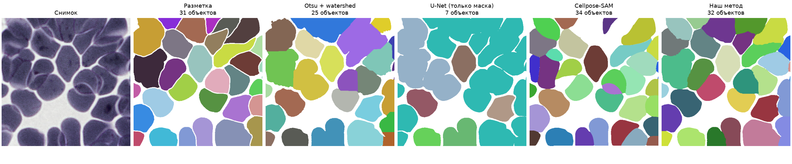

# blood-cell-sep

Метод глубокого обучения для разделения слипшихся клеток крови на микроскопических изображениях.

## Идея метода

U-Net с двумя выходами:
1. маска «клетка / фон»;
2. карта расстояний до края клетки.

Пики карты расстояний служат маркерами центров клеток, затем watershed разрезает слипшиеся комки на отдельные клетки.
Для обучения дополнительно генерируются синтетические слипания.

## Структура

```
blood-cell-sep/
  src/          # основной код: данные, модель, лоссы, постобработка, метрики
  scripts/      # запускаемые скрипты: загрузка данных, обучение, оценка
  baselines/    # методы для сравнения: Otsu+watershed, Cellpose, StarDist
  configs/      # yaml-конфиги экспериментов
  notebooks/    # EDA и картинки для отчёта
  results/      # итоговые таблицы и рисунки
  data/         # данные (не в git, заполняется скриптами)
```

## Установка

Нужен Python 3.11.

```bash
python3.11 -m venv .venv
source .venv/bin/activate          # Windows: .venv\Scripts\activate
pip install --upgrade pip
```

**PyTorch** (команда зависит от машины):

- Mac (Apple Silicon):
  ```bash
  pip install torch torchvision
  ```
- ПК с видеокартой NVIDIA: актуальную команду с нужной версией CUDA взять на
  https://pytorch.org/get-started/locally/ (вида `pip install torch torchvision --index-url https://download.pytorch.org/whl/cuXXX`).

**Остальные зависимости:**

```bash
pip install -r requirements.txt
```

**Проверка:**

```bash
python scripts/check_env.py
```

На Mac должно показать `Устройство: mps`, на ПК — `Устройство: cuda` и название видеокарты.

## Результаты

Тестовая выборка: 199 снимков BBBC041Seg, клетки у края снимка исключены (11 500 клеток).
Полные таблицы — `results/figures/tables.md`.

| Метод | F1@0.5 | AP[.5:.95] | AJI | Склеено | Разрезано | Время на снимок |
|---|---|---|---|---|---|---|
| Otsu + watershed | 0.874 | 0.622 | 0.755 | 14.8% | 1.4% | 0.44 с |
| U-Net (только маска) | 0.747 | 0.494 | 0.603 | 39.8% | 0.0% | 0.30 с |
| Cellpose-SAM (без дообучения) | 0.972 | 0.806 | 0.900 | 1.6% | 1.3% | 8.58 с |
| **U-Net + карта расстояний** | **0.967** | **0.781** | **0.895** | **1.3%** | **3.1%** | **0.38 с** |



## Воспроизведение

```bash
python scripts/download_bbbc041seg.py          # данные
python scripts/make_split.py                    # разбиение (уже в configs/)
python scripts/eda.py                           # анализ данных
python scripts/train.py --config configs/unet_dist.yaml
python scripts/tune_postprocess.py --checkpoint checkpoints/unet_dist/best.pth
python scripts/evaluate.py --method model --checkpoint checkpoints/unet_dist/best.pth --split test --tuned --exclude-border
python scripts/make_report_figures.py           # таблицы и рисунки
```

## Рабочий процесс

- Код пишется на Mac → `git push`.
- Обучение на ПК: `git pull` → скачивание данных скриптом → запуск обучения.
- Данные и веса моделей в git не хранятся.
